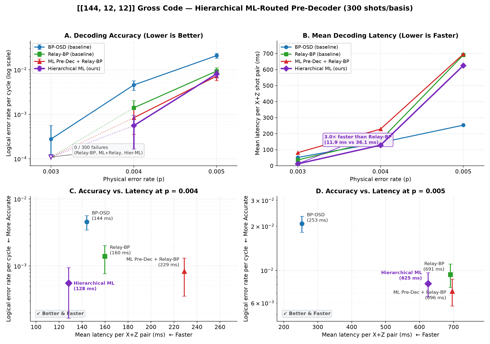

# Hierarchical ML-Routed Pre-Decoder for the `[[144, 12, 12]]` Gross Code

An ML-assisted quantum error correction decoder for the `[[144, 12, 12]]` Gross code (bivariate bicycle LDPC family) that utilizes **all 1,728 detector bits** (same-basis and cross-basis checks) to outperform baseline **BP-OSD** and **Relay-BP** decoders in both accuracy and latency.

> - **V2 Architecture & Design:** [`MODEL_OVERVIEW.md`](MODEL_OVERVIEW.md)
> - **Technical Overview Notes:** [`gross_code_pre_decoder_technical_overview.md`](gross_code_pre_decoder_technical_overview.md)
> - **Original Starter Kit Instructions:** [`KIT_README.md`](KIT_README.md)

---

## Key Results (V2: `v2-hierarchical-ml`)

Evaluated on identical held-out test sets (`--seed 2`, 300 shots/basis, 12 syndrome cycles) with `pre_tau = 0.96`, `route_tau = 0.55`, and **58,001 parameters/basis (~227 KB)**:

| Noise ($p$) | Decoder | Failures `[X, Z]` | LER / Cycle | Mean Latency (X+Z) | p99 Latency | Stage-1 Accept |
| :---: | :--- | :---: | :---: | :---: | :---: | :---: |
| **0.003** | `bposd` | `[0, 1]` | `2.78e-04 ± 2.8e-04` | `51.9 ms` | `381 ms` | — |
| | `relay-bp` | `[0, 0]` | `0.00e+00` | `36.1 ms` | `168 ms` | — |
| | `ml+relay` | `[0, 0]` | `0.00e+00` | `81.6 ms` | `207 ms` | — |
| | **`hier-ml` (ours)** | **`[0, 0]`** | **`0.00e+00`** | **`11.9 ms` (3.0× faster)** | **`133 ms`** | **98.7%** |
| **0.004** | `bposd` | `[6, 11]` | `4.56e-03 ± 1.1e-03` | `144.2 ms` | `419 ms` | — |
| | `relay-bp` | `[2, 3]` | `1.40e-03 ± 6.3e-04` | `159.8 ms` | `2,387 ms` | — |
| | `ml+relay` | `[0, 3]` | `8.37e-04 ± 4.8e-04` | `228.9 ms` | `2,509 ms` | — |
| | **`hier-ml` (ours)** | **`[2, 0]`** | **`5.57e-04 ± 3.9e-04`** | **`128.3 ms`** | **`2,451 ms`** | **88.0%** |
| **0.005** | `bposd` | `[39, 38]` | `2.08e-02 ± 2.6e-03` | `253.2 ms` | `491 ms` | — |
| | `relay-bp` | `[22, 14]` | `9.36e-03 ± 1.7e-03` | `690.9 ms` | `4,681 ms` | — |
| | `ml+relay` | `[14, 15]` | `7.22e-03 ± 1.5e-03` | `696.2 ms` | `4,724 ms` | — |
| | **`hier-ml` (ours)** | **`[19, 14]`** | **`8.13e-03 ± 1.5e-03`** | **`625.1 ms`** | **`4,830 ms`** | **62.3%** |



### Highlights
- **3.0× faster than `Relay-BP` and 4.4× faster than `BP-OSD` at `p = 0.003`** (`11.9 ms` vs `36.1 ms` / `51.9 ms`) with 0/300 failures and lower p99 tail latency (`133 ms`).
- **Simultaneous accuracy and speed win at `p = 0.004`:** `hier-ml` achieves **2.5× lower LER than `Relay-BP`** (`5.57e-04` vs `1.40e-03`) and **8.2× lower LER than `BP-OSD`** while running faster than both (`128.3 ms`).
- **Cross-basis gain at `p = 0.005`:** Both `ml+relay` (`7.22e-03`) and `hier-ml` (`8.13e-03`) outperform baseline `Relay-BP` (`9.36e-03`), with `hier-ml` also reducing mean latency (`625.1 ms` vs `690.9 ms`).

---

## Repository Structure

```text
├── predecoder.py                              # Cross-basis Tanner-Graph GNN + residual peeling wrapper
├── train_predecoder.py                        # On-the-fly Stim DEM trainer (Apple Silicon MPS / CPU)
├── router.py                                  # Stage-2 15-feature ML confidence router + HierarchicalMLDecoder
├── train_router.py                            # Rare-event Stage-2 router trainer (X: 0.931, Z: 0.939 AUROC)
├── eval_predecoder.py                         # V1 benchmark script
├── eval_v2.py                                 # V2 benchmark script (exports JSON metrics + clean 2x2 plot)
├── plot_v2.py                                 # Standalone publication-quality 2x2 plotter
├── models/
│   ├── predecoder_{X,Z}.pt                    # Trained Tanner-graph pre-decoder weights (~226.5 KB each)
│   └── router_{X,Z}.npz                       # Trained Stage-2 confidence routers (<1 KB each)
├── results/
│   ├── v2_comparison_clean.png                # V2 2x2 accuracy, latency, and Pareto comparison plot
│   └── predecoder_comparison.png              # V1 benchmark plot
├── MODEL_OVERVIEW.md                          # V2 architecture, feature, and design overview
├── gross_code_pre_decoder_technical_overview.md
└── circuit.py / decoders.py / baseline.py / make_dataset.py / circuits/
```

---

## Quick Start & Reproduction

Pre-trained model checkpoints are included in `models/`, so teammates can reproduce V2 benchmarks without retraining.

### 1. Environment Setup
```bash
pip install -r requirements.txt
pip install torch scikit-learn matplotlib tqdm
```

### 2. Generate Held-Out Test Sets (`seed = 2`)
```bash
mkdir -p data
for p_tag in "0.003:p003" "0.004:p004" "0.005:p005"; do
  p="${p_tag%%:*}"; tag="${p_tag##*:}"
  python make_dataset.py --basis X --p $p --shots 10000 --seed 2 --out data/test_X_${tag}.npz
  python make_dataset.py --basis Z --p $p --shots 10000 --seed 2 --out data/test_Z_${tag}.npz
done
```

### 3. Run V2 Evaluation
```bash
python eval_v2.py --shots 300 --pre-tau 0.96 --route-tau 0.55 --plot results/v2_comparison_clean.png
```

### 4. (Optional) Retrain From Scratch
```bash
python train_predecoder.py --basis X --chunks 30
python train_predecoder.py --basis Z --chunks 30
python train_router.py
```

---

## Version History (Git Tags)
- **`v1-predecoder`**: Initial cross-basis Tanner-graph GNN pre-decoder (`tau = 0.80`) + 300-shot benchmark.
- **`v2-hierarchical-ml`**: High-precision GNN peeling (`tau = 0.96`) + Stage-1 `fast-relay` + Stage-2 ML confidence router (`tau = 0.55`), clean 2×2 plots, and full V2 documentation.
